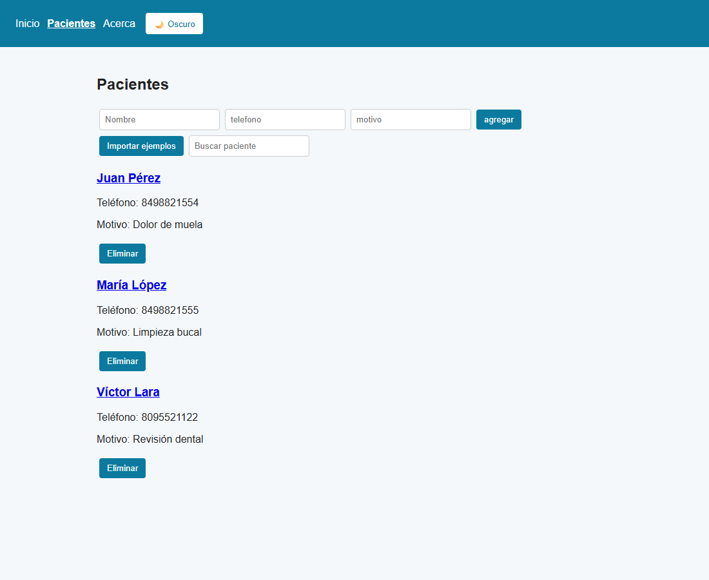

# CEUDENTAL

Aplicación web hecha con React para gestionar los pacientes de una clínica dental. Es el proyecto final del curso de React en Talendig.

## Qué hace

- Muestra la lista de pacientes con su nombre, teléfono y motivo de consulta.
- Permite agregar pacientes con un formulario y eliminarlos.
- Tiene un buscador que filtra los pacientes por nombre y muestra "Sin resultados" cuando no hay coincidencias.
- Cada paciente tiene una página de detalle.
- Los pacientes se guardan en el navegador (localStorage), así que no se pierden al recargar.
- Tiene tema claro y oscuro (`TemaContext`).
- Se puede cambiar el idioma entre español e inglés (`IdiomaContext`); cambia todos los textos de la app.

## Caso B

El proyecto corresponde al **Caso B**: tiene un botón **"Importar ejemplos"** que trae pacientes de ejemplo desde una API externa y los agrega a la lista.

## API

Se usa **JSONPlaceholder**, con el endpoint de usuarios:

```
https://jsonplaceholder.typicode.com/users
```

Los datos se cargan con el hook `useFetch` (en `src/hooks/useFetch.js`) y se convierten al formato de pacientes con `adaptarPaciente` (en `src/utils/adaptar.js`):

| API | Paciente |
|---|---|
| `name` | `nombre` |
| `phone` | `telefono` |
| — | `motivo: "Paciente importado"` |

## Rutas

| Ruta | Página |
|---|---|
| `/` | Inicio |
| `/pacientes` | Lista de pacientes, formulario, buscador e importar ejemplos |
| `/pacientes/:id` | Detalle de un paciente |
| `/acerca` | Acerca de |
| `*` | Página no encontrada (404) |

## Cómo correrla

```bash
npm install
npm run dev
```

Luego abre en el navegador el link que aparece en la terminal (normalmente `http://localhost:5173`).

## Captura



## Tecnologías

- React
- React Router
- Vite
